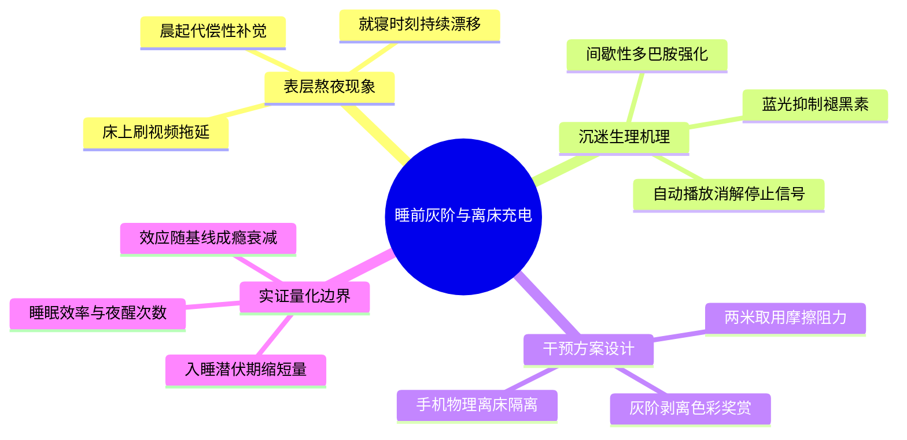

# 《“凌晨一点半综合征”：睡前短视频沉迷机制与大学生断网干预对照实验》大纲与段落契约规约

> **📌 分步构建说明（本文件由你在【任务一】和【任务二】中分两步增量完成）**：
> 1. **【任务一（00~10 min）填写前半部分】**：确立一句核心题眼填入 **“一、核心论点”**，向 AI 发送任务一 ROCA 提示词生成 Mermaid `mindmap` 思维导图，人工审视剪枝后粘贴至 **“二、发散思维导图”** 并保存；
> 2. **【任务二（10~25 min）追加后半部分】**：向 AI 发送任务二 ROCA 提示词，将上述思维导图拓扑投影为四章大纲并细化第 3 章数据槽位，追加粘贴至 **“三、拓扑排序四章制树状大纲”** 与 **“四、第 3 章段落级写作规约”** 并保存，合成完整的 `outline_spec.md`；
> 3. **【对照自检与断点兜底】**：完成任务二后，可打开 `../01_stage1_2_spec/outline_spec.md` 标准参考范例进行对照自检（若前两步调试耗时过长，也可直接复制该参考范例以保证顺利进入【任务三】）。

---

## 一、核心论点（Thesis Statement）——【任务一填写】

- **课题模式**：默认统一主线课题（或填写你的开放自选课题名称）
- **一句式核心论点**：`睡前开启手机灰阶模式与离床充电隔离，能够阻断短视频多巴胺唤醒并显著缩短大学生入睡潜伏期。`

---

## 二、发散思维导图（Mermaid Mindmap）——【任务一填写】

---

## 三、拓扑排序四章制树状大纲（Hierarchical Outline）——【任务二追加】

- **第 1 章 `1 熬夜现象
1.1 床上刷视频拖延行为
1.2 就寝时刻持续漂移
1.3 晨起代偿性补觉`**
- **第 2 章 `2 沉迷机理
2.1 间歇性多巴胺强化
2.2 蓝光抑制褪黑素
2.3 自动播放消解停止信号`**
- **第 3 章 `3 干预与实证
3.1 实验设置与基准
3.2 入睡耗时对比与机理
3.3 早八困倦率验证`**
- **第 4 章 `4 结论与边界
4.1 效应随基线成瘾衰减
4.2 干预依从率与脱落
4.3 结论外推边界与局限`**

---

## 四、第 3 章段落级写作规约（Paragraph Specification & Data Slots）——【任务二追加】

> **契约红线**：以下规约仅供【任务三：受控扩写】时结合 `raw_data.json` 注入真实数值，在本规约阶段**严禁直接填入具体数字或提前写出完整正文**。

### 3.1 实验设置与核心睡眠指标基准对比（段落契约）
- **【目标字数区间】**：`[请在任务二中由 AI 生成填入]`
- **【核心论证功能】**：`[请在任务二中由 AI 生成填入]`
- **【首尾过渡句方向】**：`[请在任务二中由 AI 生成填入]`
- **【数据槽位声明】**：`[请在任务二中声明 [待填槽位：...] 占位符，包含样本量 N 与对比三线表槽位]`

### 3.2 干预效能对比与行为阻断机理（段落契约）
- **【目标字数区间】**：`[请在任务二中由 AI 生成填入]`
- **【核心论证功能】**：`[请在任务二中由 AI 生成填入]`
- **【首尾过渡句方向】**：`[请在任务二中由 AI 生成填入]`
- **【数据槽位声明】**：`[请在任务二中声明 [待填槽位：...] 占位符，注意要求将平均入睡潜伏耗时由秒折算为分钟]`

### 3.3 日间精力恢复效应与早八课堂出勤质量验证（段落契约）
- **【目标字数区间】**：`[请在任务二中由 AI 生成填入]`
- **【核心论证功能】**：`[请在任务二中由 AI 生成填入]`
- **【首尾过渡句方向】**：`[请在任务二中由 AI 生成填入]`
- **【数据槽位声明】**：`[请在任务二中声明 [待填槽位：...] 占位符，包含次日早八困倦人数与困倦发生率对比]`
